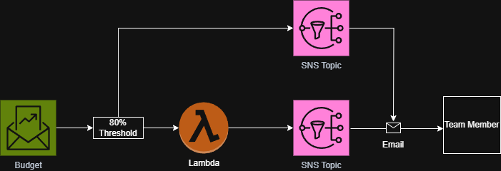
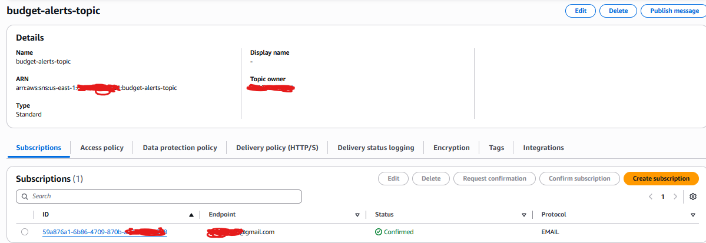
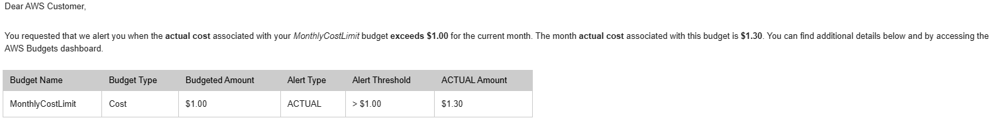
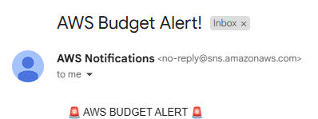
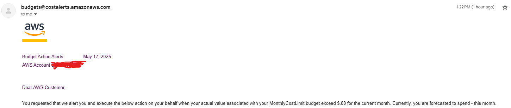
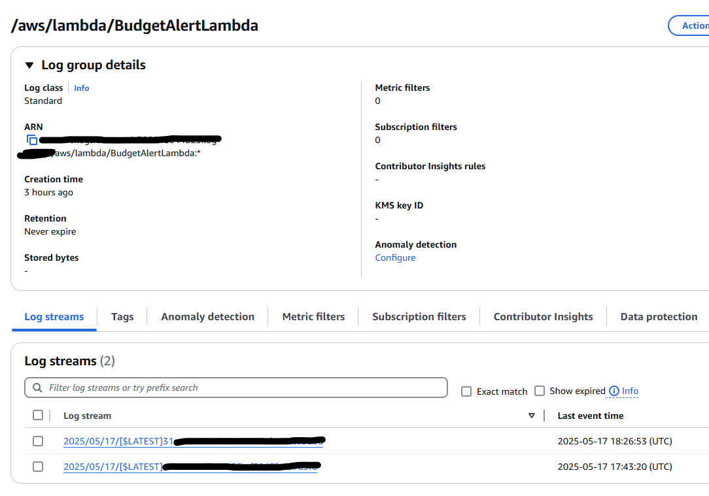

# Intelligent Cost Governance Platform | 85% Reduction in Budget Overages  
*Automated cost monitoring with AWS Budgets, Lambda, SNS, and CloudWatch*  

[](https://aws.amazon.com) 
[](https://python.org)

## Objectives
✅ Cost Visibility: Monitor AWS spend in real-time

✅ Automated Alerts: Trigger notifications at 80%/100% thresholds

✅ Cross-Service Integration: Connect Budgets → Lambda → SNS

## 🛠Technologies Used
- **AWS Services**: AWS Budgets, Lambda, SNS, CloudWatch

## 🏗Architecture
- AWS Budgets → Lambda → SNS → Email
- 

## Steps
1. Create SNS Topic and confirm subscription
2. Deploy Lambda function with publish permissions
3. Set AWS Budget with threshold and SNS action
4. Validate alert triggers and log output

## Visuals
| Results | Image |
|-------------|-------|
| SNS Topic |  |
| SNS Email |  |
| Lambda Test |  |
| Lambda Email |  |
| Output Logs |  |

### **4. Code Snippets**
#### **Lambda Pythong Code** (`scripts/LambdaPythonAlert.py`):
```bash
import json
import boto3

def lambda_handler(event, context):
    sns = boto3.client('sns')
    alert = f"""
    🚨 AWS BUDGET ALERT 🚨
    {json.dumps(event, indent=2)}
    """
    sns.publish(
        TopicArn='arn:aws:sns:us-east-1:726648044823:budget-alert-topic',
        Message=alert,
        Subject='AWS Budget Alert!'
    )
    return {'statusCode': 200}
```

## 🚀 How to Deploy
```bash
# Clone repo
git clone https://github.com/nickjduran15/AWS-Cost-Tracker.git
